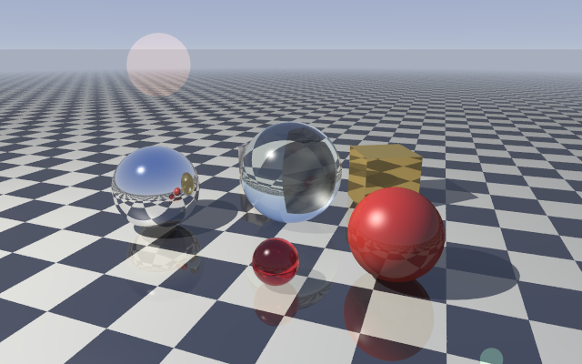
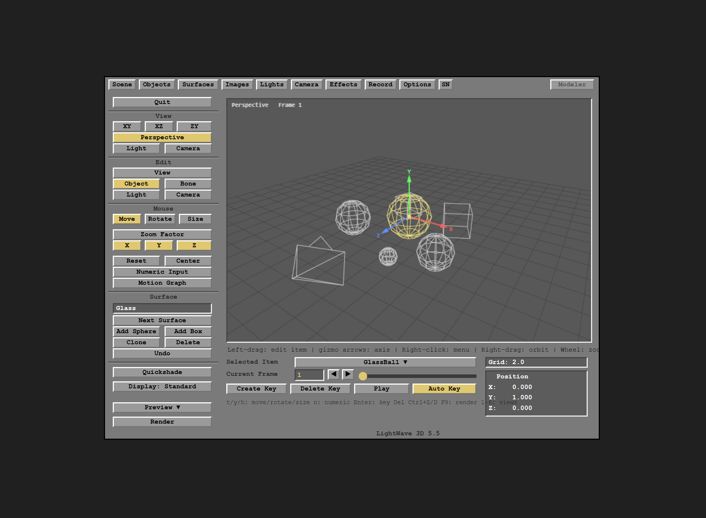

# LightWave 5.5-style Ray Tracer

A tribute to **LightWave 3D 5.5 (1997)**: a mini 3D layout program with the classic grey 90s interface and a real ray tracer, all in a **single HTML/JS file**. No install, no build, no dependencies.





🎬 **[Watch the demo video](lightwave_demo_45s_v3.mp4)**: rendering, moving objects, surfaces, views and a physics drop with collisions.

## Run

Open `lightwave.html` in any modern browser.

## Features

**Rendering**
- Real recursive ray tracing: glass refraction with Fresnel, mirror/chrome and tinted metal reflections
- Ray-traced and soft (area) shadows, fog, sky gradient, lens flare
- Procedural textures: checkerboard, stripes, marble
- Anti-aliasing (1 / 4 / 9 / 16 rays per pixel)
- Multi-threaded: uses every CPU core via Web Workers
- Line-by-line progress bar, elapsed/remaining time, Save RGB (PNG)

**Layout**
- Views: XY, XZ, ZY, Perspective, Light, Camera (with safe frame)
- Move / Rotate / Size with on-screen axis gizmo, X/Y/Z axis locks, snap to grid
- Right-click context menus, numeric input, undo
- Quickshade: live ray-traced viewport preview
- Standard (pixel-exact) or Responsive (scale to window) display

**Panels**
- Scene (frames, fps, recursion depth, save/load scene as JSON)
- Objects, Surfaces (live preview ball), Images (background image), Lights, Camera, Effects, Record, Options

**Animation**
- Keyframes with smooth spline interpolation, Auto Key, Motion Graph
- **Drop with Physics**: gravity, bounce and collisions baked into keyframes
- Record: renders the full animation and plays it back

## Controls

| Input | Action |
|---|---|
| Left-drag | Move / rotate / size selected item |
| Drag gizmo arrow | Move along one axis |
| Shift + drag | Move vertically |
| Right-drag / Alt + drag | Orbit view |
| Middle-drag | Pan |
| Wheel | Zoom |
| Right-click | Context menu |
| `t` `y` `h` | Move / Rotate / Size |
| `n` | Numeric input |
| `Enter` | Create key |
| `Del`, `Ctrl+D`, `Ctrl+Z` | Delete, clone, undo |
| `←` `→`, `Space` | Step frames, play |
| `p`, `F9`, `F10` | Quick render, render, record |
| `1`–`6` | XY, XZ, ZY, Perspective, Light, Camera views |
| `q` | Toggle Quickshade |

## How it works

Everything below lives in the `<script id="core">` block of `lightwave.html`. It's about 150 lines, and the same code runs in the main thread and in the render workers.

### 1. Camera rays

For each pixel `(x, y)` the camera shoots a ray `P(t) = O + t·D`. The camera has an orbit target `T`, a heading (yaw) `θ`, a pitch `φ` and a distance `d`, so its position is

```
O = T + d · (sin θ cos φ,  sin φ,  cos θ cos φ)
```

From that we build an orthonormal basis: forward `f = normalize(T − O)`, right `r = normalize(f × up)`, up `u = r × f`. Zoom factor `z` gives the half-height of the image plane, `h = 1/z`, and the vertical field of view is `2·atan(1/z)`. The pixel's direction is

```
D = normalize( f + r · (2(x+sx)/W − 1) · h · aspect + u · (1 − 2(y+sy)/H) · h )
```

`(sx, sy)` is a sub-pixel offset. With anti-aliasing at N×N, each pixel averages N² jittered rays (stratified sampling), which smooths the jagged edges.

### 2. Intersections

**Sphere** (centre `C`, radius `R`): substitute the ray into `|P − C|² = R²` and you get a quadratic. Writing `oc = O − C`:

```
t² + 2(oc·D)t + (oc·oc − R²) = 0
b = oc·D,  h = b² − (oc·oc − R²)
h < 0 → miss;  otherwise t = −b ± √h  (take the smallest t > ε)
```

**Box** (rotated about Y): rotate the ray into the box's local space with the inverse rotation `Ry(−α)`. There it's an axis-aligned box, which you hit-test with the **slab method**. On each axis compute where the ray enters and leaves the slab, `t₁,₂ = (±R − o_k)/d_k`. Then `t_near = max(t₁)` and `t_far = min(t₂)`, and the ray hits when `t_near ≤ t_far`. The normal is the local axis with the largest `|p_k|`, rotated back to world space.

**Floor**: the plane `y = 0` gives `t = −O_y / D_y`.

The closest positive `t` over all objects is the hit. `ε ≈ 10⁻⁴` stops a ray from re-hitting the surface it just left ("shadow acne").

### 3. Shading (Phong / Blinn-Phong)

At hit point `P` with normal `N`, light direction `L` and view direction `V = −D`:

```
ambient  = k_a
diffuse  = k_d · max(0, N·L)                      (Lambert)
specular = k_s · max(0, N·H)^n,  H = normalize(L + V)   (Blinn half-vector)
color    = base · (ambient + I_light · diffuse · shadow) + I_light · specular · shadow
```

`n` is the "Glossiness": higher values give smaller, sharper highlights. Metallic surfaces tint the specular highlight and reflections with their own colour, which is what makes gold look like gold.

### 4. Shadows

A **shadow ray** goes from `P` toward the light. If any object sits between them, the point is in shadow. Transparent objects pass light through in proportion to their transparency, so glass casts a lighter shadow.

**Soft shadows**: the light is treated as a small cube of size `s`. Each shadow ray aims at a random point inside it, so a pixel's samples are partly blocked and partly not. Averaged over the samples, that gives a soft edge (the penumbra).

### 5. Reflection and refraction (the recursive part)

This is what makes it *ray tracing* rather than plain rasterization. The `shade()` function calls itself.

**Reflection**: `R = D − 2(D·N)N`. Trace `R` and blend the result in by the surface's reflectivity.

**Refraction** (Snell's law): `η₁ sin θ₁ = η₂ sin θ₂`. With `η = η₁/η₂` and `cos θᵢ = −D·N`:

```
k = 1 − η²(1 − cos²θᵢ)
k < 0  → total internal reflection
T = η·D + (η cos θᵢ − √k) · N
```

When the ray is leaving the object (`D·N > 0`), the normal is flipped and `η` inverted.

**Fresnel** (Schlick's approximation) controls how much light reflects and how much passes through:

```
R₀ = ((1 − ior)/(1 + ior))²
F  = R₀ + (1 − R₀)(1 − cos θᵢ)⁵
glass = F · reflected + (1 − F) · refracted
```

That's why glass acts almost like a mirror at grazing angles and is clear when you look straight through it. Recursion stops at the *Ray Recursion Limit* (6 by default).

### 6. Textures, fog, sky, gamma

- **Checker**: `(⌊x·s⌋ + ⌊y·s⌋ + ⌊z·s⌋) mod 2` picks one of two colours.
- **Marble**: `sin(x + turbulence(p))`, where turbulence is a sum of sine "noise" functions, and the result blends the two colours.
- **Fog**: `c = mix(c, sky, clamp((t − min)/(max − min)))`, so it grows with distance.
- **Sky**: a gradient from the horizon colour to the zenith colour, driven by `D_y`.
- **Gamma**: shading is computed in linear light, and the output is encoded as `255 · c^(1/1.8)`, the classic 90s Mac/Amiga-era gamma.

### 7. Parallel rendering

Every pixel is independent, so the image splits trivially across threads (an "embarrassingly parallel" problem). The scene is copied to `N = navigator.hardwareConcurrency` Web Workers. Worker `k` renders rows `k, k+N, k+2N, …` and streams each finished row back to the canvas, which is why the image fills in like the original renderer did.

### 8. Keyframe animation

Each item stores keys `{frame, state}`. The values in between come from a **Catmull-Rom spline** through the neighbouring keys `P₀..P₃`:

```
P(t) = ½ [ 2P₁ + (−P₀+P₂)t + (2P₀−5P₁+4P₂−P₃)t² + (−P₀+3P₁−3P₂+P₃)t³ ]
```

This gives smooth motion that passes through every key.

### 9. Physics ("Drop with Physics")

The motion is computed once, step by step (**semi-implicit Euler** integration with 20 sub-steps per frame), and saved as one keyframe per frame:

```
v.y −= g·Δt          (g = 9.81)
p   += v·Δt
```

- **Floor contact**: clamp `p.y = r` and set `v.y = −e·v.y`. `e` is the coefficient of restitution (bounciness), and friction damps the horizontal speed.
- **Sphere–sphere**: if `|p − c| < r₁ + r₂`, push the ball out along the normal `n = normalize(p − c)`.
- **Sphere–box**: transform the ball into the box's local space and clamp it to the box to find the closest point `q`. If `|p − q| < r`, it's a collision with normal `n = normalize(p − q)`.
- **Response**: when `v·n < 0` (the ball is moving into the object), reflect the normal part of the velocity: `v −= (1+e)(v·n)n`.

## Story

In 1997 I ran LightWave 3D 5.5 on a Pentium 133 MHz and didn't sleep for a day. Almost 30 years later, this mini version was built in conversation with [Claude Code](https://claude.com/claude-code).

*Not affiliated with LightWave 3D or its owners. This is an independent, nostalgic tribute.*
